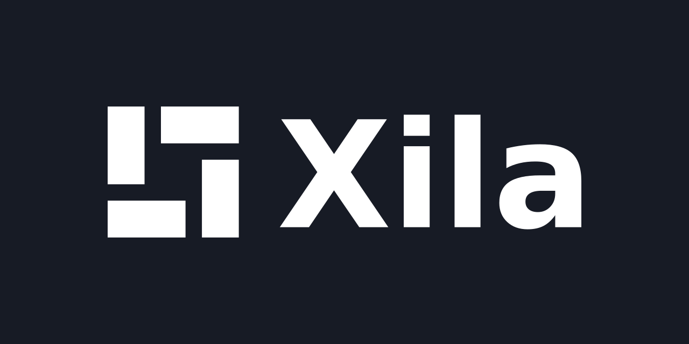

# Xila visual identity

The source assets, usage guide and exports for the **Continuity** direction selected by Alix ANNERAUD on 17 October 2026.



The identity keeps the original four rectangular modules. The revised symbol uses lighter strokes and wider separations. It deliberately remains abstract; it does not introduce a literal X.

## Get the right file

| Use | Asset |
| --- | --- |
| Symbol on a light background | [Ink SVG](assets/symbol/xila-symbol-ink.svg) or [black SVG](assets/symbol/xila-symbol-black.svg) |
| Symbol on a dark background | [White SVG](assets/symbol/xila-symbol-white.svg) |
| Symbol and name on a light background | [Horizontal ink SVG](assets/lockup/xila-horizontal-ink.svg) |
| Symbol and name on a dark background | [Horizontal white SVG](assets/lockup/xila-horizontal-white.svg) |
| Organization / community avatar | [512px PNG](assets/avatar/xila-avatar-512.png) |
| Repository social preview | [1280 × 640 PNG](assets/social/xila-social-1280x640.png) |
| Browser tab | [SVG favicon](assets/favicon/favicon.svg) and [ICO fallback](assets/favicon/favicon.ico) |
| Raster integrations | [PNG exports](exports/png/) at 16–1024 pixels |
| Website migration | [Compatibility exports](integrations/website/) |

SVG lockups contain outlined lettering and need no installed font. `DejaVu Sans Bold` matches the selected proposal's lettering; the font and its license are included for reproducibility. It is a practical initial choice, not a bespoke typeface.

## Source of truth

- [source/symbol.svg](source/symbol.svg): editable four-rectangle master.
- [source/identity.json](source/identity.json): palette, font, spacing and version.
- [docs/visual-guidelines.md](docs/visual-guidelines.md): construction and usage rules.
- [docs/migration.md](docs/migration.md): migration from `xila-project/website`.
- [legacy/](legacy/): original website assets, preserved byte for byte with provenance.
- [manifest.json](manifest.json): SHA-256 hashes for generated delivery assets.

Black and white are the primary identity. Ink/paper are neutral presentation colors. Indigo is an optional exploration and is not required for adoption of the selected symbol.

## Regenerate

Python 3.10+ and Cairo are required. On Debian/Ubuntu, install `libcairo2` if Cairo is unavailable. From this repository:

```sh
python3 -m venv .venv
. .venv/bin/activate
python -m pip install -r requirements.txt
python scripts/export.py
python scripts/validate.py
```

All design inputs and the font are local. Regeneration does not fetch network assets. Edit `source/`, then regenerate; do not edit generated SVGs or PNGs individually. Commit generated exports so consumers do not need Python or Cairo.

## Apply to a local website checkout

```sh
python scripts/sync_website.py /path/to/website
```

This explicit command replaces only the three existing logo files under `src/public/images`. It leaves configuration, documentation and unrelated images untouched. Review its diff and run the website's own checks before opening a PR. Existing public URLs remain stable.

## Licensing and attribution

The repository retains the website's [Apache-2.0 license](LICENSE). Original Xila artwork: Alix ANNERAUD. The revised artwork is a derivative dated 17 October 2026. See [NOTICE](NOTICE), the original file manifest and the separate [font license](fonts/LICENSE-DejaVu.txt). This repository does not assert that Xila is a registered trademark or grant endorsement rights.

## Agent instructions

[AGENTS.md](AGENTS.md) is the shared instruction source. `CLAUDE.md`, `GEMINI.md` and `.github/copilot-instructions.md` are relative symbolic links to it; Codex and OpenCode can read `AGENTS.md` directly.
